<div align="center">

<a href="https://jaineil32624.github.io/RedFlag/">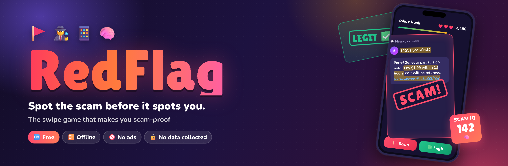</a>

<br>

<a href="https://jaineil32624.github.io/RedFlag/"></a>
<a href="https://github.com/jaineil32624/RedFlag/releases/latest/download/RedFlag.zip"></a>
<a href="https://jaineil32624.github.io/RedFlag/"></a>
<a href="https://jaineil32624.github.io/RedFlag/"></a>

<sub>📲 <b>Install as app:</b> open the play link on your phone → browser menu → <b>Add to Home Screen</b> / <b>Install app</b>. It then works offline like a native app.</sub>

<br><br>


</div>

---

## 🚩 Scammers are fast. Now you can be faster.

Scams cost people worldwide **hundreds of billions of dollars every year**. It's fake parcel texts, *"Hi Mum, new number"* messages, AI-cloned voices, fake tech support, romance cons, crypto "mentors" and jobs that ask you to pay a fee. Most victims aren't careless. They were rushed.

**RedFlag** trains the one thing that actually stops a scam: **the reflex to pause and spot the red flag.** You swipe through realistic texts, emails, DMs, voicemails and QR codes. Swipe left for scam, right for legit. After every card you see exactly what gave it away. It's quick, it's fun, and it works for everyone from teens to grandparents. 🧠

<div align="center">

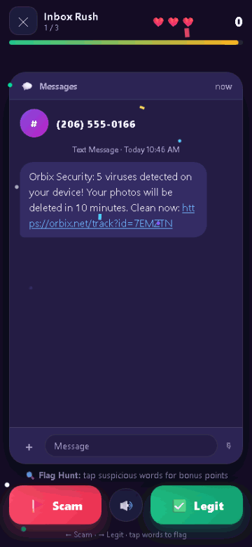

<sub>👆 Swipe it, stamp it, learn why. One card takes about 10 seconds.</sub>

</div>

## 📸 Screenshots

<div align="center">

<table>
  <tr>
    <td align="center">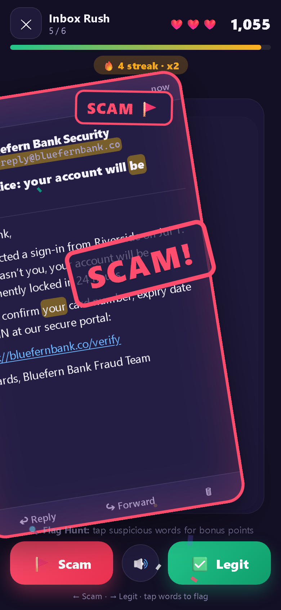<br><b>📱 Inbox Rush</b><br><sub>Swipe ← scam · legit →</sub></td>
    <td align="center">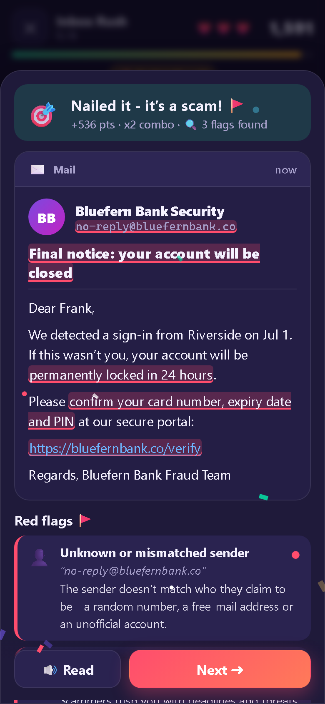<br><b>🔍 See every red flag</b><br><sub>Highlighted right in the message</sub></td>
    <td align="center">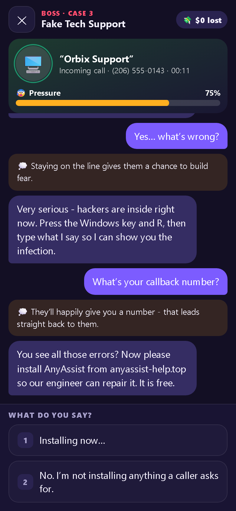<br><b>🗂️ Boss fights</b><br><sub>Talk your way out of a live scam</sub></td>
  </tr>
  <tr>
    <td align="center">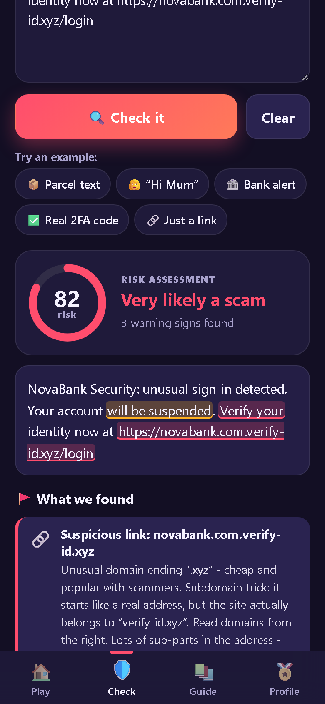<br><b>🛡️ Check a Message</b><br><sub>A real, private scam checker</sub></td>
    <td align="center">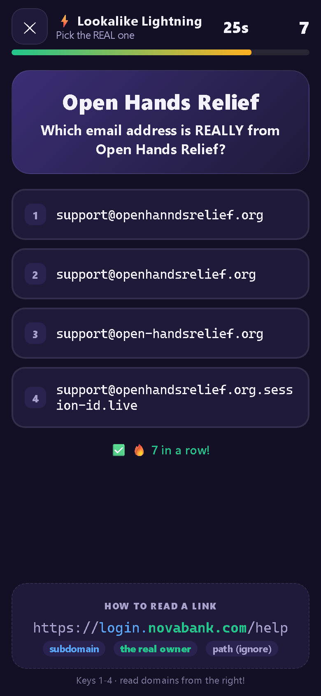<br><b>⚡ Lookalike Lightning</b><br><sub>Spot the real link in 30s</sub></td>
    <td align="center">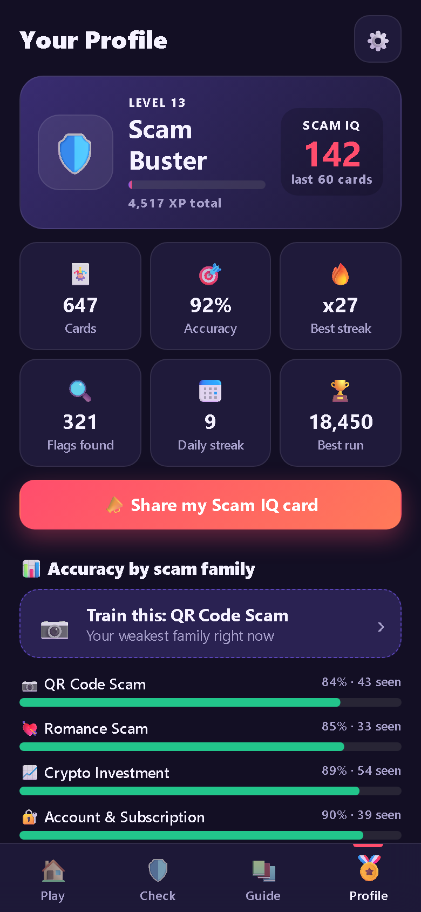<br><b>🧠 Scam IQ & ranks</b><br><sub>Rookie → Legend</sub></td>
  </tr>
  <tr>
    <td align="center">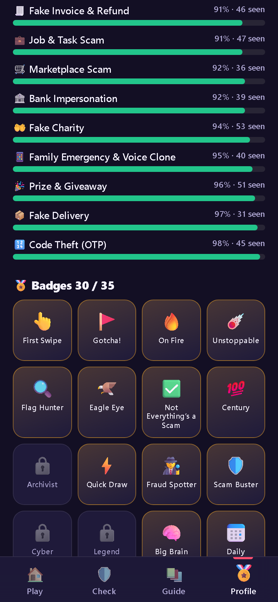<br><b>🏅 35 badges</b><br><sub>Plus stats for every scam family</sub></td>
    <td align="center">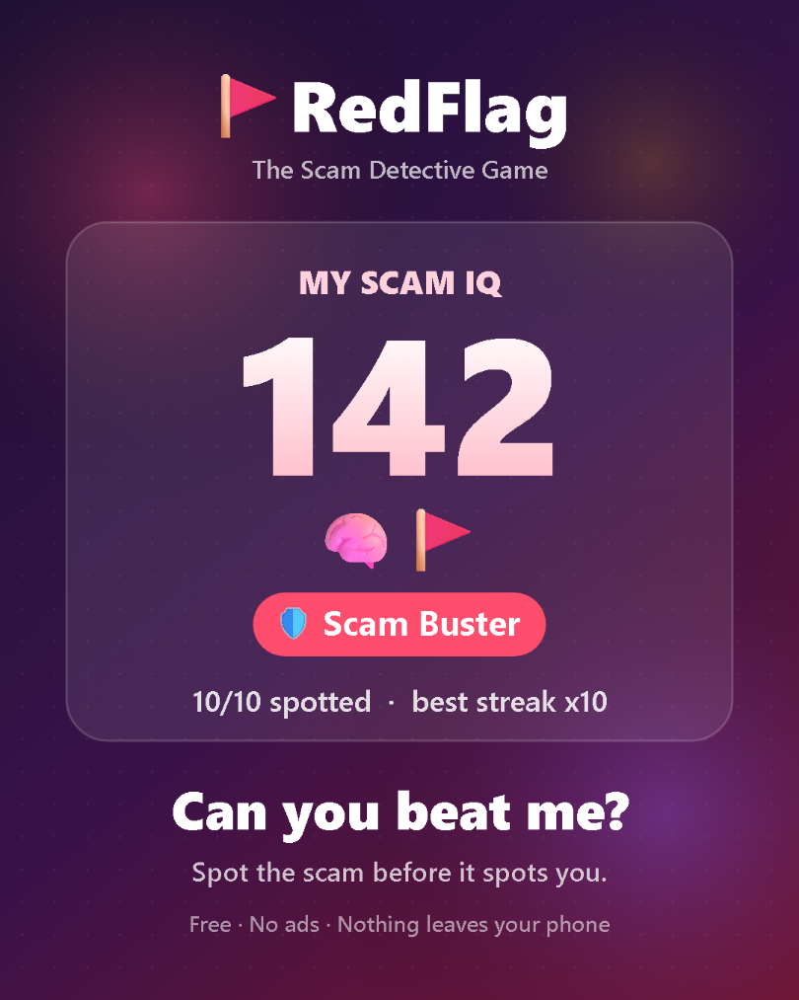<br><b>📣 Share your Scam IQ</b><br><sub>Then challenge your friends</sub></td>
    <td align="center">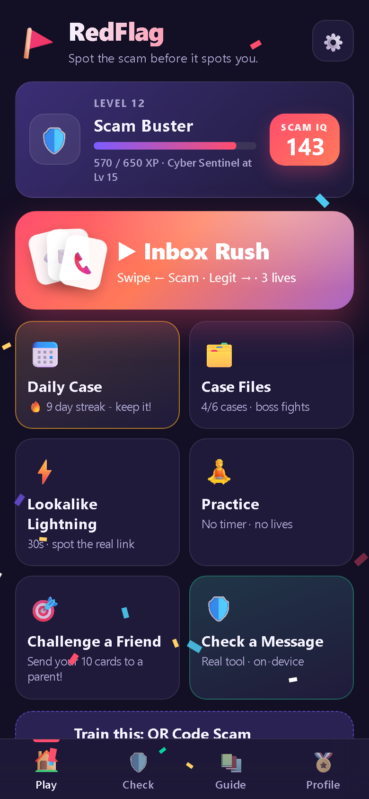<br><b>🏠 Daily Case & streaks</b><br><sub>New cards every day</sub></td>
  </tr>
</table>

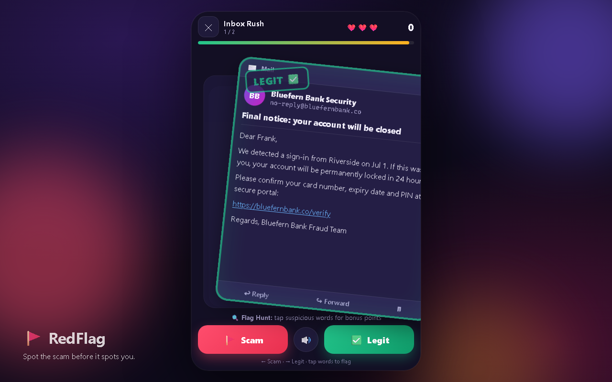<br>
<sub>💻 Looks great on desktop too.</sub>

</div>

## 🎮 Game modes

| | |
|---|---|
| 📱 **Inbox Rush** | The core game. Messages land one at a time: texts, emails, DMs, voicemails, marketplace chats, job offers, crypto pitches and QR posters. You get a timer, a combo multiplier and 3 lives. **Flag Hunt:** tap the suspicious words before you swipe to earn bonus points. |
| 🗂️ **Case Files** | Six story chapters, each ending in a **boss fight**: a voice-clone *"Mum, I'm in trouble"* call, a fake tech-support call with a rising 😰 pressure meter, a romance scammer over several days, a crypto mentor, a job that needs a fee and an overpaying buyer. |
| ⚡ **Lookalike Lightning** | You have 30 seconds. Is it `novabank.com`, `n0vabank.com` or `novabank.com.verify-id.xyz`? Pick the real one, fast. |
| 📅 **Daily Case** | Everyone gets the same 10 cards each day. Keep your 🔥 streak alive. |
| 🧘 **Practice** | No timer and no lives. Calm learning at your own pace. |
| 🎯 **Challenge a Friend** | Send someone your exact 10 cards along with your score to beat. |

And it's **not** "everything is a scam". Real fraud alerts, 2FA codes you requested and genuine delivery notices are in the mix too. You learn to tell the difference instead of panicking at every message. ✅

## 🛡️ Check a Message: a real tool

Got a weird text right now? Paste it into **Check a Message**. RedFlag will:

- 🎯 score the risk from **0 to 100**
- 🖍️ highlight the red flags inside the text: urgency, code requests, gift cards and crypto, "new number" claims, remote-access requests, overpayments and more
- 🔗 show who **really** owns each link. It catches lookalikes, shortened links, IP addresses, odd domain endings, and tricks like `brand.com.something.xyz` or an `@` hidden in the URL
- ✅ give you a plain-language **"What to do now"** checklist

It runs **100% on your device**. Nothing is uploaded, and links are never opened. It's an honest heuristic, not a guarantee, so always verify through the company's official app or phone number.

## 👵 Send it to your parents

Scammers target the people we love most. RedFlag is built for exactly that conversation.

- 🎯 **Challenge links:** play 10 cards, then send the link. Your mum, dad or grandpa gets **the exact same 10 cards** and sees your score to beat. No account and no install needed.
- 👪 **Family mode:** large text, high contrast, 🔊 read-aloud for every message and explanation, relaxed timers or no timer at all, and reduced motion.
- 💬 **Gentle lessons:** every card explains *why* in one plain sentence. There's no jargon and no shaming.

> 💡 Tip: agree on a **family safe word** today. It beats any AI voice clone. RedFlag's "Hi Mum" boss fight shows why.

## 🚀 Play in 10 seconds

| | |
|---|---|
| 🌐 **Online** | Open **[jaineil32624.github.io/RedFlag](https://jaineil32624.github.io/RedFlag/)** and start swiping. |
| 📲 **Install on your phone** | Open the link on your phone, then choose **Add to Home Screen** (iPhone: Share → Add to Home Screen). It works offline afterwards. |
| ⬇️ **Download** | Get **[RedFlag.zip](https://github.com/jaineil32624/RedFlag/releases/latest/download/RedFlag.zip)**, unzip it and double-click **`index.html`**. No install and no internet needed. |

## 🔒 Privacy

**RedFlag collects nothing.** There are no accounts, no ads, no analytics and no trackers, and the app makes no server calls at all. Your progress stays in your own browser, and the message checker never sends your text anywhere. Read the [privacy policy](privacy-policy.html).

All brands, people, links and phone numbers in the game are **fictional** and used only for education.

---

<div align="center">

### Ready to get scam-proof? 🚩

<a href="https://jaineil32624.github.io/RedFlag/"></a>
<a href="https://github.com/jaineil32624/RedFlag/releases/latest/download/RedFlag.zip"></a>

**⭐ If RedFlag helped you (or someone you love), please star the repo.** It helps more people find it.

</div>

---

<details>
<summary><b>🛠️ For developers: features, how to run, architecture, adding scam templates</b></summary>

<br>

## ✨ Features

| | |
|---|---|
| 📱 **Inbox Rush** | A realistic phone shows one message at a time - SMS, email, social DM, marketplace chat, voicemail transcript, QR poster, job offer, crypto pitch. **Swipe ← Scam 🚩 / Legit ✅ →** (touch drag with card physics, arrow keys, or buttons). Timer, combo multiplier, 3 lives. |
| 🔍 **Flag Hunt** | Tap suspicious words *before* swiping for bonus points: urgency, lookalike links, gift-card/crypto/wire payments, code & password requests, too-good-to-be-true offers, unknown senders, tone mismatches, emotional pressure, secrecy, overpayment… |
| 💡 **Instant lessons** | After every card a sheet reveals the red flags (or the green flags proving it's legit) highlighted right inside the message. |
| ✅ **Not everything is a scam** | Tricky *scary-but-real* messages: genuine fraud alerts that say "we will never ask for your code", 2FA codes you requested, real delivery notices on the official domain. |
| ♾️ **Procedural content** | **69 scam templates across 15 scam families + 30 legit templates**, with randomised names, amounts, dates, fictional brands and lookalike-domain mutations. Difficulty scales with your level (subtler lookalikes, fewer typos, more convincing fakes). |
| 🗂️ **Story Mode: Case Files** | 6 chapters, each ending in an interactive **boss**: "Hi Mum" voice-clone call, overpaying marketplace buyer, fake tech support (with a rising **pressure meter**), the job that needs a fee, a multi-day romance scammer, and a crypto mentor. Good choices end the scam safely; bad ones show what you'd have lost - and why. Stars + unlocks. |
| ⚡ **Lookalike Lightning** | 30-second speed round: pick the real domain/sender from homoglyphs (`n0vabank.com`), extra words, wrong endings and subdomain tricks (`novabank.com.verify-id.xyz`). |
| 📅 **Daily Case** | A date-seeded set of 10 cards - the same for everyone that day - with streak tracking. |
| 🛡️ **Check a Message** | Paste any text or link. The on-device analyzer scores risk 0-100, highlights red flags inline and explains them in plain language, inspects links (real owner domain, IP links, shorteners, punycode, odd endings, brand-in-subdomain, `@` tricks) and ends with a **"What to do now"** checklist. Honest: heuristic, *not a guarantee*. |
| 📚 **Field Guide** | Searchable encyclopedia of scam types that unlocks as you meet them: how it works, red flags, what to do. |
| 🏅 **Progression** | XP & levels, ranks (**Rookie → Fraud Spotter → Scam Buster → Cyber Sentinel → Legend**), a difficulty-weighted **Scam IQ**, **35 badges** with unlock animations, per-category accuracy and "train your weak spot". |
| 📣 **Viral loop** | Beautiful **share card** rendered to canvas → PNG (Web Share with files, or download). **Challenge links** (`#challenge=SEED&score=N`) give a friend the *exact same 10 cards* and your score to beat. Copy-link fallback. |
| 👪 **Family & accessibility** | Large text, high contrast, reduced motion, **read-aloud** (SpeechSynthesis) for cards & explanations, relaxed timers or no-timer Practice, light/dark themes. |
| 🎆 **Juice** | Swipe physics, SCAM!/LEGIT rubber stamps, screen shake, confetti, procedural Web Audio SFX + optional generative music (remembers toggle & volume, starts after first tap, pauses when hidden), haptics. **No audio or image assets needed.** |

---

## 🎮 How to play

1. **Read the message.** Who sent it? Where does the link *really* go? What are they asking for?
2. **Flag Hunt (optional):** tap anything suspicious for bonus points. 🔍
3. **Swipe left** if it's a scam 🚩, **swipe right** if it's legit ✅ (or use ← / → keys or the big buttons).
4. **Learn** from the feedback sheet, build your combo, and climb from Rookie to Legend. 👑
5. **Challenge** your friends and family to beat your Scam IQ. 🎯

---

## ▶️ How to run

**Easiest:** double-click `index.html`. That's it. 🎉

**As a PWA (installable, offline):** serve the folder over http(s), e.g.

```bash
# any static server works
npx serve .            # or: python -m http.server 8000
```

then open `http://localhost:8000`. On GitHub Pages, enable Pages for the repo and visit `https://<you>.github.io/RedFlag/` - the browser will offer **Install app**.

**Android (Google Play):** see [`docs/PLAY_STORE.md`](docs/PLAY_STORE.md) for the store listing kit and Capacitor wrapping steps.

---

## 🏗️ Architecture

One global namespace (`window.RedFlag`), classic `<script>` tags in a fixed order - no modules, no bundler, works on `file://`.

```
RedFlag/
├── index.html                 # shell + script order
├── css/styles.css             # design tokens, themes (dark/light/contrast/large/reduced-motion)
├── js/
│   ├── core/                  # namespace + utils + event bus, seeded RNG, versioned storage
│   ├── content/
│   │   ├── brands.js          # the FICTIONAL world: banks, couriers, apps, domains, names
│   │   ├── domains.js         # lookalike-domain generator (3 difficulty tiers)
│   │   ├── taxonomy.js        # red-flag & green-flag types, scam categories
│   │   ├── templates-scam.js  # 69 scam templates
│   │   ├── templates-legit.js # 30 legit templates (incl. scary-but-real)
│   │   ├── generator.js       # template + seed + level → card; deck building
│   │   ├── fieldguide.js      # encyclopedia entries
│   │   └── stories.js         # Case Files + branching boss scripts
│   ├── systems/               # settings, audio (procedural), haptics/speech, progress (XP/IQ/stats),
│   │                          # badges, daily + challenge seeds, share card
│   ├── analyzer/analyzer.js   # on-device "Check a Message" heuristics
│   ├── ui/                    # router & dialogs, fx, card renderer, swipe physics, screens
│   ├── game/                  # run engine (Rush/Daily/Challenge/Practice/Story rounds), story, lookalike
│   └── main.js                # boot
├── sw.js                      # offline cache (only registered over http/https)
├── manifest.webmanifest       # PWA manifest (injected only over http/https)
├── icons/                     # 192, 512, maskable 512 PNG + SVG
├── privacy-policy.html        # "we collect nothing"
└── docs/PLAY_STORE.md         # store listing + Capacitor steps
```

Key ideas:
- **Seeded RNG** (`core/rng.js`) makes Daily Cases and Challenge links reproducible - the same seed always builds the same deck.
- **Storage** (`core/storage.js`) keeps one versioned JSON blob in `localStorage`, wrapped in try/catch; if storage is blocked the game runs in memory.
- **Event bus** (`RedFlag.bus`) decouples systems from UI - e.g. `badge` and `levelup` events trigger the unlock animations.
- **Screens** register in `RedFlag.screens` and are navigated with `RedFlag.ui.go(name, params)`; the browser/Android back button is wired to history.

---

## ➕ How to add a scam template

Open `js/content/templates-scam.js` (or `templates-legit.js`) and add an object:

```js
{ id: 'del-locker-sms',            // unique id
  cat: 'delivery',                 // category from taxonomy.js
  ch: 'sms',                       // sms | email | dm | market | voicemail | qr | job | crypto
  diff: 2,                         // 1 obvious … 3 subtle
  brand: 'courier',                // brand type used by {{brand}}, {{domain}}, {{fakeUrl}}…
  from: '[[sender|{{phone}}]]',
  body: '{{brand}}: your parcel {{trk}} is waiting in locker #{{num}}. ' +
        '[[urgency|Collect within 12h]] after paying {{small}}: [[link|{{fakeUrl}}]]',
  lesson: 'Parcel lockers never need a payment link by text.' }
```

- `{{var}}` inserts random values - see `VARS` in `js/content/generator.js` (`{{brand}}`, `{{fakeUrl}}`, `{{amt}}`, `{{p1}}`, `{{code}}`, `{{b:shop}}`…).
- `[[type|text]]` marks a **red flag** span (types in `taxonomy.js`: `urgency`, `link`, `payment`, `codes`, `tgtbt`, `sender`, `tone`, `emotion`, `secrecy`, `overpay`, `remote`, `info`).
- `[[+type|text]]` marks a **green flag** span for legit templates (`official`, `noask`, `expected`, `verify`, `calm`, `known`).
- Lines in `body` are separated by `\n`; a line starting with `me:` becomes your own chat bubble. Optional fields: `addr`, `subject`, `qr`, `ctx` (situational context), `listing: true`.
- ⚠️ Keep it **fictional and defensive**: only fictional brands/domains from `brands.js`, phone numbers via `{{phone}}` (555-01xx), and never real working links.


</details>

---

## ⚠️ Disclaimer

RedFlag is an educational game. The message checker is a heuristic helper, **not a guarantee** - always verify through the organisation's official app, website or phone number. All companies, people, domains and numbers in the game are **fictional**.

## 📄 License

[MIT](LICENSE) © 2026 Jaineil Rana
